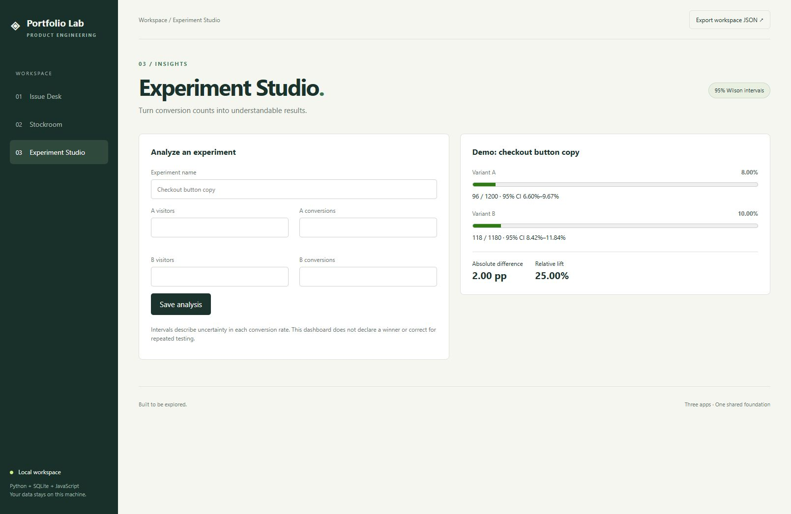

# Portfolio Lab

Sixteen working applications in a shared, dependency-free Python workspace: product, data, defensive security, machine-learning, cloud/DevOps, and REST API collections. Browser interfaces, JSON APIs, SQLite persistence, stateless analysis, and regression tests are included.



| App | What it does | Engineering focus |
| --- | --- | --- |
| Issue Desk | Create, search, prioritize, and move issues across a three-stage board | Audit events, validation, idempotent status updates |
| Stockroom | Track products, receipts, withdrawals, and reorder thresholds | Immutable movement ledger, concurrent-write correctness |
| Experiment Studio | Save A/B conversion counts and compare rates with 95% Wilson intervals | Numeric validation, statistical edge cases, uncertainty presentation |
| Dataset Explorer | Profile uploaded CSVs, missingness, duplicates, frequent values, and numeric distributions | Bounded parsing, type inference, descriptive statistics |
| Pipeline Studio | Trim cells, drop blank rows, deduplicate, and export cleaned CSVs | Ordered transformations, idempotence, safe exports |
| Revenue Lens | Map sales columns, aggregate month/category totals, and inspect rejected records | Decimal arithmetic, validation, transparent data quality reporting |
| Auth Watch | Analyze authentication logs for failure bursts and suspicious success sequences | Rolling windows, event ordering, detection-rule tests |
| Header Review | Review pasted HTTP response headers and cookie attributes | Policy heuristics, ambiguity handling, actionable findings |
| Secret Sentinel | Identify credential patterns without returning raw secret values | Pattern matching, overlap deduplication, report redaction |
| Classifier Lab | Train and export a binary logistic regression model | Reproducible splits, training-only scaling, held-out evaluation |
| Retrieval Studio | Rank documents with explainable TF-IDF similarity | Sparse vectors, cosine similarity, term contributions |
| Model Observatory | Inspect classification metrics and threshold tradeoffs | Tied-rank AUC, calibration bins, probability losses |
| Manifest Review | Review selected Kubernetes Deployment policies | Structured configuration checks, scoped findings |
| Pipeline Planner | Simulate dependency graphs, workers, and retries | Discrete-event scheduling, cycle detection, failure propagation |
| Reliability Desk | Calculate request-based SLO budgets and burn rates | Weighted aggregation, gap detection, explicit reporting windows |
| REST Studio / Notes API | Authenticated CRUD, search, pagination, and request inspection | OpenAPI, ETags, idempotency, transaction-safe concurrent writes |

The REST explorer is at **http://127.0.0.1:8000/rest**. Follow [REST API setup](docs/REST_API.md) to configure `PORTFOLIO_API_KEY` before starting the server. The OpenAPI contract is served at `/openapi.json`.

The cloud/DevOps apps are at **http://127.0.0.1:8000/devops**. See [DevOps Lab documentation](docs/DEVOPS_LAB.md). These are local review and simulation tools; no cloud resources are created.

The ML apps are at **http://127.0.0.1:8000/ml**. See [ML Lab documentation](docs/ML_LAB.md) for algorithms, API contracts, and limitations. Retrieval uses a lexical baseline, not neural semantic embeddings.

The security apps are at **http://127.0.0.1:8000/security**. See [Security Lab documentation](docs/SECURITY_LAB.md) for samples, rule definitions, and limitations.

The three data apps are at **http://127.0.0.1:8000/data** after starting the server. Use **Load sample** for fictional data containing deliberate quality problems. See [Data Lab documentation](docs/DATA_LAB.md).

## Run locally

Requires Python 3.11 or later. No pip packages required. Run from this repository:

```sh
python -m portfolio.seed
python -m portfolio.server
```

Open http://127.0.0.1:8000. The optional seed command creates fictional demo records only in an empty database. Skip it to start empty. Data persists in `data/portfolio.db` and is excluded from Git. Stop the server with Ctrl+C.

For a separate workspace or a different port:

```sh
python -m portfolio.server --port 8080 --database data/another.db
```

## Verify

```sh
python -m unittest discover -s tests -v
node --check portfolio/static/app.js
```

Node is optional for running the apps; it is used only for the JavaScript syntax check. CI runs the Python tests on 3.11, 3.12, and 3.13. The original nine tests cover real HTTP behavior, persistence, validation, SQL-like input, duplicate SKUs, audit events, Wilson boundaries, rollback on overdraw, and simultaneous withdrawals through separate connections.

Manual browser smoke checks verified issue creation, navigation across all three apps, rendering saved experiment results, and a visible error when withdrawing four units from a product with three available. Automated end-to-end browser and mobile viewport tests are future work.

The full suite now contains 73 tests: nine original domain/API tests, ten data tests, thirteen security tests, thirteen ML tests, thirteen DevOps tests, and fifteen REST tests. CI also checks JavaScript syntax for all six interfaces.

## Architecture

```text
Browser: semantic HTML + responsive CSS + vanilla JavaScript
    → HTTP JSON adapter (portfolio/server.py)
    → domain operations (portfolio/services.py)
    → SQLite transactions and constraints (portfolio/db.py)
```

Each HTTP request opens and closes its own database connection. Stock mutations acquire `BEGIN IMMEDIATE` before reading the ledger balance, so two withdrawals cannot both spend the same units. Failed mutations roll back. Inventory balances derive from the ledger rather than a second mutable counter. Issue status changes and audit entries commit together. Repeating the current status adds no extra event.

The UI uses escaped text, native labeled controls, live status messages, disabled submit buttons while saving, and mobile breakpoints. Navigation is deep-linkable with `#tickets`, `#inventory`, and `#experiments`. The export button downloads the loaded workspace snapshot; events and movements are limited to the latest 100, so it is **not a full database backup**. For a full backup, stop the server and copy the SQLite database.

## API

The original product endpoints below require `Content-Type: application/json` and `X-Portfolio-Client: browser` for POST. Successful creates return 201; status updates return 200. Invalid inputs return 400, missing resources 404, and conflicting SKUs 409. Errors have an `error` string. The separate versioned Notes API uses API-key authentication and problem-details errors; see its dedicated documentation.

| Method | Endpoint | Body |
| --- | --- | --- |
| GET | `/api/state` | None; returns tickets, events, products, movements, experiments |
| POST | `/api/tickets` | `title`, `description`, `priority` (low/medium/high) |
| POST | `/api/tickets/{id}/status` | `status` (backlog/active/done) |
| POST | `/api/products` | `name`, `sku`, `reorder_point` (integer ≥ 0) |
| POST | `/api/movements` | `product_id`, `delta` (nonzero signed integer), `note` |
| POST | `/api/experiments` | `name`, `a_visitors`, `a_conversions`, `b_visitors`, `b_conversions` |

Counts must be integers; visitors must be positive and conversions cannot exceed visitors. Relative lift is undefined (`null`, shown as N/A) when baseline conversion is zero. Absolute difference is B minus A. Wilson intervals describe each proportion; they are not a hypothesis test or a sequential testing procedure.

## Scope and limitations

This is a local, single-user portfolio demo, not an internet-ready service. It binds to loopback and uses Python's development HTTP server. The Notes API has shared-key authentication and pagination; the original apps remain unauthenticated. There is no multi-user authorization, rate limiting, migration runner, or cloud deployment. The custom JSON header and content security policy are limited defense-in-depth measures, not substitutes for production security. Data refreshes after local actions or page reload; there is no live collaboration.

The initial implementation was created with AI assistance. Commit timestamps reflect actual development milestones; no historical activity is simulated. Demo records and experiment outcomes are fictional. See [DEVELOPMENT.md](DEVELOPMENT.md) for practical follow-up work and interview preparation.
