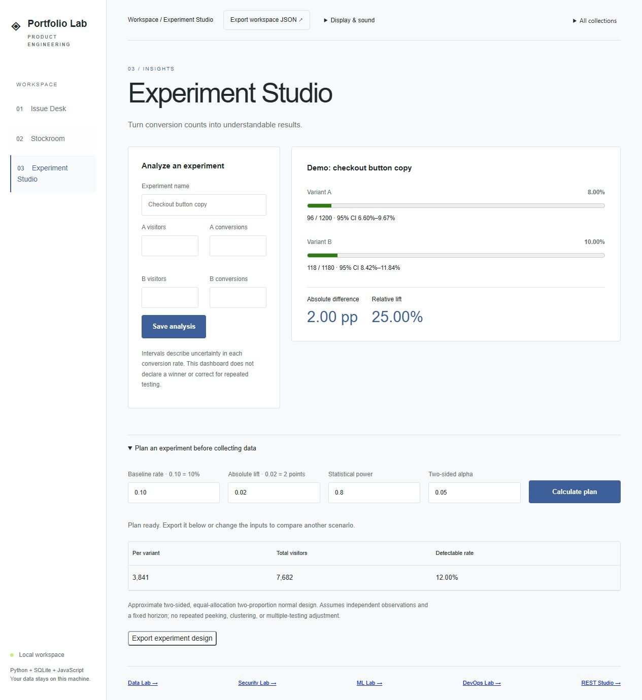

# Portfolio Lab

Sixteen working applications in a shared, dependency-free Python workspace: product, data, defensive security, machine-learning, cloud/DevOps, and REST API collections. Browser interfaces, JSON APIs, SQLite persistence, stateless analysis, and regression tests are included.



| App | What it does | Engineering focus |
| --- | --- | --- |
| Issue Desk | Create, search, prioritize, and move issues across a three-stage board | Audit events, validation, idempotent status updates |
| Stockroom | Track products, receipts, withdrawals, and reorder thresholds | Immutable movement ledger, concurrent-write correctness |
| Experiment Studio | Save A/B conversion counts and compare rates with 95% Wilson intervals | Numeric validation, statistical edge cases, uncertainty presentation |
| Dataset Explorer | Profile uploaded CSVs, missingness, duplicates, frequent values, and numeric distributions | Bounded parsing, type inference, descriptive statistics |
| Pipeline Studio | Trim cells, drop blank rows, deduplicate, and export cleaned CSVs | Ordered transformations, idempotence, safe exports |
| Revenue Lens | Map sales columns, aggregate month/category totals, and inspect rejected records | Decimal arithmetic, validation, transparent data quality reporting |
| Auth Watch | Analyze authentication logs for failure bursts and suspicious success sequences | Rolling windows, event ordering, detection-rule tests |
| Header Review | Review pasted HTTP response headers and cookie attributes | Policy heuristics, ambiguity handling, actionable findings |
| Secret Sentinel | Identify credential patterns without returning raw secret values | Pattern matching, overlap deduplication, report redaction |
| Classifier Lab | Train and export a binary logistic regression model | Reproducible splits, training-only scaling, held-out evaluation |
| Retrieval Studio | Rank documents with explainable TF-IDF similarity | Sparse vectors, cosine similarity, term contributions |
| Model Observatory | Inspect classification metrics and threshold tradeoffs | Tied-rank AUC, calibration bins, probability losses |
| Manifest Review | Review selected Kubernetes Deployment policies | Structured configuration checks, scoped findings |
| Pipeline Planner | Simulate dependency graphs, workers, and retries | Discrete-event scheduling, cycle detection, failure propagation |
| Reliability Desk | Calculate request-based SLO budgets and burn rates | Weighted aggregation, gap detection, explicit reporting windows |
| REST Studio / Notes API | Authenticated CRUD, search, pagination, and request inspection | OpenAPI, ETags, idempotency, transaction-safe concurrent writes |

The REST explorer is at **http://127.0.0.1:8000/rest**. Follow [REST API setup](docs/REST_API.md) to configure `PORTFOLIO_API_KEY` before starting the server. The OpenAPI contract is served at `/openapi.json`.

The cloud/DevOps apps are at **http://127.0.0.1:8000/devops**. See [DevOps Lab documentation](docs/DEVOPS_LAB.md). These are local review and simulation tools; no cloud resources are created.

The ML apps are at **http://127.0.0.1:8000/ml**. See [ML Lab documentation](docs/ML_LAB.md) for algorithms, API contracts, and limitations. Retrieval uses a lexical baseline, not neural semantic embeddings.

The security apps are at **http://127.0.0.1:8000/security**. See [Security Lab documentation](docs/SECURITY_LAB.md) for samples, rule definitions, and limitations.

The three data apps are at **http://127.0.0.1:8000/data** after starting the server. Use **Load sample** for fictional data containing deliberate quality problems. See [Data Lab documentation](docs/DATA_LAB.md).

## Minimal workspaces

Inspired by [Orennia's](https://orennia.com/) restrained navigation, spacing, and headline hierarchy, the apps use quiet surfaces, thin dividers, and a limited accent palette. Each retains its own layout and subtle identity. Decorative illustrations, textures, extra theme banners, and ambient animations have been removed. Short headline entrances, one-time panel reveals, gentle disclosure transitions, and result feedback add motion without extra visual elements. Content remains visible without animation or JavaScript observation; the Motion control and system reduced-motion preference disable these effects.

Secondary analysis settings, detailed reports and exports, product planning tools, and REST filters/headers expand on demand. Invalid fields reopen their containing section. The **Display & sound** menu holds optional synthesized feedback and motion preferences; sound remains off by default and system reduced-motion settings take precedence.

| App | Visual direction |
| --- | --- |
| [Issue Desk](docs/design/issue-desk.png) | Indigo accents, quiet kanban lanes |
| [Stockroom](docs/design/stockroom.png) | Warm neutral ledger, full-width navigation |
| [Experiment Studio](docs/design/experiment-studio.png) | Blue accents, chart-first results |
| [Dataset Explorer](docs/design/dataset-explorer.png) | Green accents, compact input sidebar |
| [Pipeline Studio](docs/design/pipeline-studio.png) | Cool blue palette, horizontal source and cleaning controls |
| [Revenue Lens](docs/design/revenue-lens.png) | Warm editorial typography, report-first columns |
| [Auth Watch](docs/design/auth-watch.png) | Dark green console, monospace heading |
| [Header Review](docs/design/header-review.png) | Blue guide with a compact input sidebar |
| [Secret Sentinel](docs/design/secret-sentinel.png) | Muted rose accents, spacious source review |
| [Classifier Lab](docs/design/classifier-lab.png) | Soft green workspace, notebook layout |
| [Retrieval Studio](docs/design/retrieval-studio.png) | Warm serif heading, prominent query bar |
| [Model Observatory](docs/design/model-observatory.png) | Dark neutral instrument panel, sage accents |
| [Manifest Review](docs/design/manifest-review.png) | Cool drafting palette, source/result comparison |
| [Pipeline Planner](docs/design/pipeline-planner.png) | Violet accents, wide timeline |
| [Reliability Desk](docs/design/reliability-desk.png) | Teal accents, report-first layout |
| [REST Studio](docs/design/rest-studio.png) | Charcoal and mint, split request/response panes |

Browser QA exercised all twelve analysis samples and the authenticated Notes list request. All sixteen interfaces were checked at 390px width without horizontal page overflow; analysis samples were also run at that width. [Mobile example](docs/design/mobile-reliability.png). These are manual checks, not an automated visual regression suite.

## Everyday interactions

Use **All collections** to move between workspaces. Each analysis app offers a task-specific starting state and **Load an example** action. Run with **Ctrl+Enter** (or **Command+Enter**), then use **View results** to move keyboard focus directly to the report. Editing an input clears its previous report and prompts a rerun.

Issue Desk shows filtered counts and a clear-filters action. Product forms keep save feedback beside the submit button. REST Studio labels the last request with its method, URL, status, and completion time, locks request controls while sending, and supports copying the response body. API keys remain unsaved.

The refinement pass manually verified example loading across all twelve analysis apps, result focus, input invalidation, keyboard execution, skip navigation, issue filtering, response copying, and collection-menu layouts across all sixteen apps at 390px width.

## Deeper capabilities and demo guide

| App | Added capability | Demo / engineering evidence |
| --- | --- | --- |
| Issue Desk | Assignees, due dates, overdue labels, editable assignments | Expand a card to update ownership; changes persist with an idempotent audit event. Existing databases upgrade without losing tickets. |
| Stockroom | Lead-time and safety-coverage replenishment plans | Calculate a plan below the ledger; inspect trailing 30-day withdrawals, days of coverage, and recommended order quantities; export JSON. |
| Experiment Studio | Sample-size planning | Enter baseline, minimum absolute lift, power, and alpha below saved experiments; export a fixed-horizon experiment design. |
| Dataset Explorer | IQR outlier diagnostics and pairwise correlations | Run numeric CSV data; inspect flagged record numbers and complete-pair counts. Constant columns are undefined, not zero correlation. |
| Pipeline Studio | Row-level cleaning provenance | Trace each source record to its output record or removal reason; export the full formula-safe audit CSV. |
| Revenue Lens | Monthly growth and refund reconciliation | Inspect consecutive-month growth, missing-month gaps, gross sales, refunds, and net amount. |
| Auth Watch | Prioritized incident queue | Group related alerts by source IP, with implicated-user counts, first/last alert times, and triggered rules. |
| Header Review | Policy baseline comparisons | Paste an earlier header block under Analysis settings; identify status improvements and regressions without exporting header values. |
| Secret Sentinel | Configurable scan gate and redacted CSV export | Choose high-only or medium-and-high severity; inspect PASS/BLOCK, per-rule counts, and export locations/remediation without matched values. |
| Classifier Lab | Batch inference using the trained model | Train, then paste unlabeled feature rows below the model report; reuse training scaling and export predictions. The inference API also accepts a saved model object. |
| Retrieval Studio | BM25 and TF-IDF ranking comparison | Select BM25 and a result limit; compare both scores for returned documents. BM25 scores are not probabilities. |
| Model Observatory | Cost-sensitive threshold evaluation | Set false-positive and false-negative costs; inspect the 0.1-step threshold grid and lowest-cost candidate on the supplied data. |
| Manifest Review | Deployment resource envelope | Inspect CPU/memory requests and limits per container and multiplied by replica count. Missing/unsupported units remain unknown. |
| Pipeline Planner | Worker-capacity comparison | Compare 1–8 workers using the same dependency/retry simulation, elapsed time, and utilization. |
| Reliability Desk | Two-window burn-rate checks | Set a threshold for both 1-hour and 6-hour windows; distinguish firing, not firing, and insufficient data. |
| REST Studio | In-memory request history and collection export | Prepare one of the last ten requests without sending it. Export method/path/body/header snapshots; API-key authentication is excluded. |

All diagnostics state their assumptions in the UI. The sample-size planner uses a pooled null variance and an unpooled alternative variance with the usual normal approximation, ignoring the far tail when solving for sample size; see the [statsmodels reference](https://www.statsmodels.org/v0.14.6/generated/statsmodels.stats.proportion.samplesize_proportions_2indep_onetail.html). It is not a sequential-testing engine. Replenishment uses observed withdrawals, not a learned forecast. Resource envelopes exclude rollout surge and init-container scheduling. Burn checks evaluate uploaded data, not live production traffic.

The new analysis fields are included in existing JSON report downloads. Cleaning additionally exports a complete row-audit CSV; secret scans export redacted finding CSVs. Numeric prediction exports include all rows, while the UI previews the first 50. Nothing is deployed to cloud infrastructure by these features.

### Extension API examples

All extension routes require `Content-Type: application/json` and `X-Portfolio-Client: browser`, like the existing local APIs:

- `POST /api/tickets/{id}/details`: `{ "assignee": "Review team", "due_date": "2026-12-01" }`. Empty strings clear assignment/deadline. Changes are audited; repeating identical values adds no event.
- `POST /api/extensions/stock-plan`: `{ "lead_days": 7, "safety_days": 7 }`. Reads persisted stock movements; writes no purchase orders.
- `POST /api/extensions/experiment-plan`: `{ "baseline": 0.1, "absolute_lift": 0.02, "power": 0.8, "alpha": 0.05 }`. Returns 3,841 visitors per variant for this example.
- `POST /api/extensions/predict`: `{ "model": <model object from training report>, "csv": "feature_a,feature_b\n1,2", "threshold": 0.5 }`. Matches feature names, validates vector lengths/scales, and reuses the fitted preprocessing.

Optional settings on existing routes: `baseline_text` for header review, `gate_severity` for secret scans, `algorithm`/`top_k` for retrieval, `false_positive_cost`/`false_negative_cost` for evaluation, and `burn_threshold` for reliability. Existing defaults remain compatible. These local extension routes are separate from the versioned Notes API and its OpenAPI contract.

### Resume discussion prompts

Describe what you can demonstrate and explain. Examples to adapt after reviewing the implementation:

- Implemented transactional SQLite workflows with audit trails, additive schema migration, and concurrent stock-withdrawal protection.
- Built reproducible model training and batch inference with training-only preprocessing, held-out evaluation, and cost-sensitive decision analysis.
- Developed bounded data-quality pipelines with row-level provenance and formula-safe CSV exports.
- Implemented dependency-graph simulation, resource-capacity analysis, and SLO diagnostics with explicit missing-data semantics.
- Built an authenticated REST API with optimistic concurrency and idempotent creation, plus an inspectable request client.

Avoid claiming production deployments, real business impact, or forecast accuracy from synthetic demos. The repository includes AI-assisted implementation; understand the tradeoffs and tests before presenting the work.

### Feature polish verification

The latest pass verified every populated workspace at 390px width without horizontal page overflow. All twelve analysis apps rejected empty input, recovered with samples, and exported parseable reports. Cleaning audits retained all 12 sample source records while cleaned CSV contained 10 output records; secret finding exports omitted matched values. REST checks covered 401-to-200 recovery, ten-entry history truncation, replay preparation without sending, credential-free collection export, and clearing key/history on reload.

Regression fixes include stock-plan invalidation after inventory changes (including results from an in-flight calculation), context-aware Ctrl/Command+Enter for prediction and planning, required numeric settings, quoted CSV feature names in prediction examples, plain-decimal revenue validation, and date-aware replenishment windows that exclude future/old withdrawals. Assignment saves now retain local feedback and keyboard focus. Diagnostic tables use bounded scrolling, keyboard focus, and readable numeric formatting; exports preserve full precision.

The automated suite covers 101 domain/API cases. Interaction, download, and responsive checks above are manual browser checks, not an automated cross-browser compatibility guarantee.

## Run locally

Requires Python 3.11 or later. No pip packages required. Run from this repository:

```sh
python -m portfolio.seed
python -m portfolio.server
```

Open http://127.0.0.1:8000. The optional seed command creates fictional demo records only in an empty database. Skip it to start empty. Data persists in `data/portfolio.db` and is excluded from Git. Stop the server with Ctrl+C.

For a separate workspace or a different port:

```sh
python -m portfolio.server --port 8080 --database data/another.db
```

## Verify

```sh
python -m unittest discover -s tests -v
node --check portfolio/static/app.js
```

Node is optional for running the apps; it is used only for the JavaScript syntax check. CI runs the Python tests on 3.11, 3.12, and 3.13. The original nine tests cover real HTTP behavior, persistence, validation, SQL-like input, duplicate SKUs, audit events, Wilson boundaries, rollback on overdraw, and simultaneous withdrawals through separate connections.

Manual browser smoke checks verified issue creation, navigation across all three apps, rendering saved experiment results, and a visible error when withdrawing four units from a product with three available. Automated end-to-end browser and mobile viewport tests are future work.

The full suite now contains 101 tests: eleven product/domain/HTTP tests, ten data tests, thirteen security tests, thirteen ML tests, thirteen DevOps tests, fifteen REST tests, and twenty-six capability tests. CI also checks JavaScript syntax for all six interfaces and the shared identity and capability controllers.

## Architecture

```text
Browser: semantic HTML + responsive CSS + vanilla JavaScript
    → HTTP JSON adapter (portfolio/server.py)
    → domain operations (portfolio/services.py)
    → SQLite transactions and constraints (portfolio/db.py)
```

Each HTTP request opens and closes its own database connection. Stock mutations acquire `BEGIN IMMEDIATE` before reading the ledger balance, so two withdrawals cannot both spend the same units. Failed mutations roll back. Inventory balances derive from the ledger rather than a second mutable counter. Issue status changes and audit entries commit together. Repeating the current status adds no extra event.

The UI uses escaped text, native labeled controls, live status messages, disabled submit buttons while saving, and mobile breakpoints. Navigation is deep-linkable with `#tickets`, `#inventory`, and `#experiments`. The export button downloads the loaded workspace snapshot; events and movements are limited to the latest 100, so it is **not a full database backup**. For a full backup, stop the server and copy the SQLite database.

## API

The original product endpoints below require `Content-Type: application/json` and `X-Portfolio-Client: browser` for POST. Successful creates return 201; status updates return 200. Invalid inputs return 400, missing resources 404, and conflicting SKUs 409. Errors have an `error` string. The separate versioned Notes API uses API-key authentication and problem-details errors; see its dedicated documentation.

| Method | Endpoint | Body |
| --- | --- | --- |
| GET | `/api/state` | None; returns tickets, events, products, movements, experiments |
| POST | `/api/tickets` | `title`, `description`, `priority` (low/medium/high) |
| POST | `/api/tickets/{id}/status` | `status` (backlog/active/done) |
| POST | `/api/products` | `name`, `sku`, `reorder_point` (integer ≥ 0) |
| POST | `/api/movements` | `product_id`, `delta` (nonzero signed integer), `note`, optional `request_key` |
| POST | `/api/experiments` | `name`, `a_visitors`, `a_conversions`, `b_visitors`, `b_conversions` |

Counts must be integers; visitors must be positive and conversions cannot exceed visitors. Relative lift is undefined (`null`, shown as N/A) when baseline conversion is zero. Absolute difference is B minus A. Wilson intervals describe each proportion; they are not a hypothesis test or a sequential testing procedure.

## Scope and limitations

This is a local, single-user portfolio demo, not an internet-ready service. It binds to loopback and uses Python's development HTTP server. The Notes API has shared-key authentication and pagination; the original apps remain unauthenticated. There is no multi-user authorization, rate limiting, migration runner, or cloud deployment. The custom JSON header and content security policy are limited defense-in-depth measures, not substitutes for production security. Data refreshes after local actions or page reload; there is no live collaboration.

The initial implementation was created with AI assistance. Commit timestamps reflect actual development milestones; no historical activity is simulated. Demo records and experiment outcomes are fictional. See [DEVELOPMENT.md](DEVELOPMENT.md) for practical follow-up work and interview preparation.

### Retry-safe stock movements

Stockroom generates a request key for each movement. Retrying the unchanged form after a network failure reuses that key for the lifetime of the page. The server records the key and ledger entry in the same transaction, so concurrent retries write only once. A replay returns the original movement ID and balance with `replayed: true`; the current balance is available from `/api/state`. Reusing a key with different movement data returns HTTP 409. Rejected movements do not consume keys. API callers should retain and reuse their own key when retrying. Reloading the browser clears its pending key.
