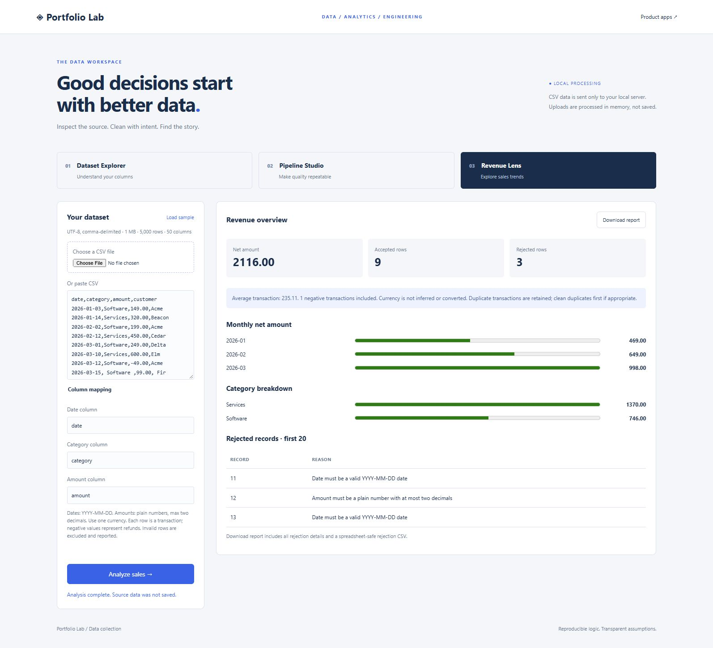

# Data Lab

Run `python -m portfolio.server` from the repository root and open http://127.0.0.1:8000/data. No third-party packages or API keys are required. The product-app footer links to Data Lab.

## Three applications

**Dataset Explorer** accepts a CSV file or pasted data and reports row/column counts, missing cells, exact duplicate rows, distinct values, and five most frequent values per column. Numeric columns receive min, max, mean, and median in the downloadable JSON; mean and median also appear in the UI. Empty/whitespace-only cells are missing; literal NA and null strings are ordinary text. Column profiling trims values, while duplicate detection compares original rows. Numeric inference requires all nonblank values to parse as finite numbers within ±1e100. IDs that look numeric may be classified as numeric; inference is descriptive, not a schema guarantee.

**Pipeline Studio** applies optional steps in a fixed order: trim cells, remove all-blank rows, then deduplicate. It reports changes and previews 20 rows without altering the input. Download produces a full cleaned CSV. Formula-like text starting with =, +, -, or @ is prefixed with an apostrophe; plain negative decimal numbers are preserved. Tabs/carriage returns at the start of untrimmed cells are also protected. This intentionally changes formula-like text in exported data. No imputation, fuzzy matching, date conversion, or automatic repair is performed.

**Revenue Lens** maps named date, category, and amount columns. Accepted rows are aggregated by month and category using Decimal arithmetic. Negative transactions are refunds and remain in net totals. Each row is treated as one transaction, duplicate rows remain included, and amounts must use one currency. There is no currency inference, exchange-rate conversion, forecasting, or business-impact claim. Amounts are limited to ±1 billion and at most two decimal places; dates must be valid YYYY-MM-DD. Average amounts use Decimal's default half-even rounding. Invalid rows are excluded from totals and reported with logical CSV record numbers (header is record 1), reasons, and original values. The JSON download contains the complete report plus a spreadsheet-safe rejected-record CSV string.

## Data and API contracts

Data is processed in memory by the loopback-only server, never inserted into SQLite or committed to Git. Reloading clears input/results. Downloads are saved only when requested. Inputs are bounded to 1,000,000 UTF-8 bytes, 5,000 data rows, and 50 columns. Blank physical rows are skipped, headers are trimmed and must be unique, and ragged records are rejected. Quoted fields, commas, embedded newlines, and UTF-8 BOMs are supported. Python CSV's standard per-field limit also applies (normally 131,072 characters).

All endpoints return 200 on success or 400 for invalid data and require the same JSON/custom-header contract as the existing API:

| Endpoint | JSON body |
| --- | --- |
| POST `/api/data/profile` | `{"csv":"name,amount\nA,10"}` |
| POST `/api/data/clean` | `{"csv":"name,amount\nA,10", "options":{"trim":true,"deduplicate":true,"drop_empty":true}}` |
| POST `/api/data/sales` | `{"csv":"date,category,amount\n2026-01-01,A,10", "mapping":{"date":"date","category":"category","amount":"amount"}}` |

These are bounded, local analytics apps, not a distributed ETL service. The browser shows a limited preview but downloads contain the full processed result. The monthly display lists observed months only; absent months are not zero-filled. Horizontal meters share a range within each chart; exact signed totals are printed beside them.

## Verification and next milestones

Data tests cover malformed CSV, multiline quoting, BOMs, missing values, duplicates, numeric edge cases, transformation order, idempotence, safe export, exact decimal totals, refunds, invalid dates, column mappings, and HTTP input validation. Browser smoke checks exercise all three apps using the fictional sample. File chooser and mobile viewport automation are not included.

Useful follow-ups: schema contracts with per-column validation rules, saved pipeline configurations, Parquet support, source-to-output lineage, large-file streaming, SQL transformations, and scheduled ingestion. For interviews, explain the distinction between row rejection and whole-file rejection, why Decimal is used for monetary aggregation, and why missing values are not automatically filled.
