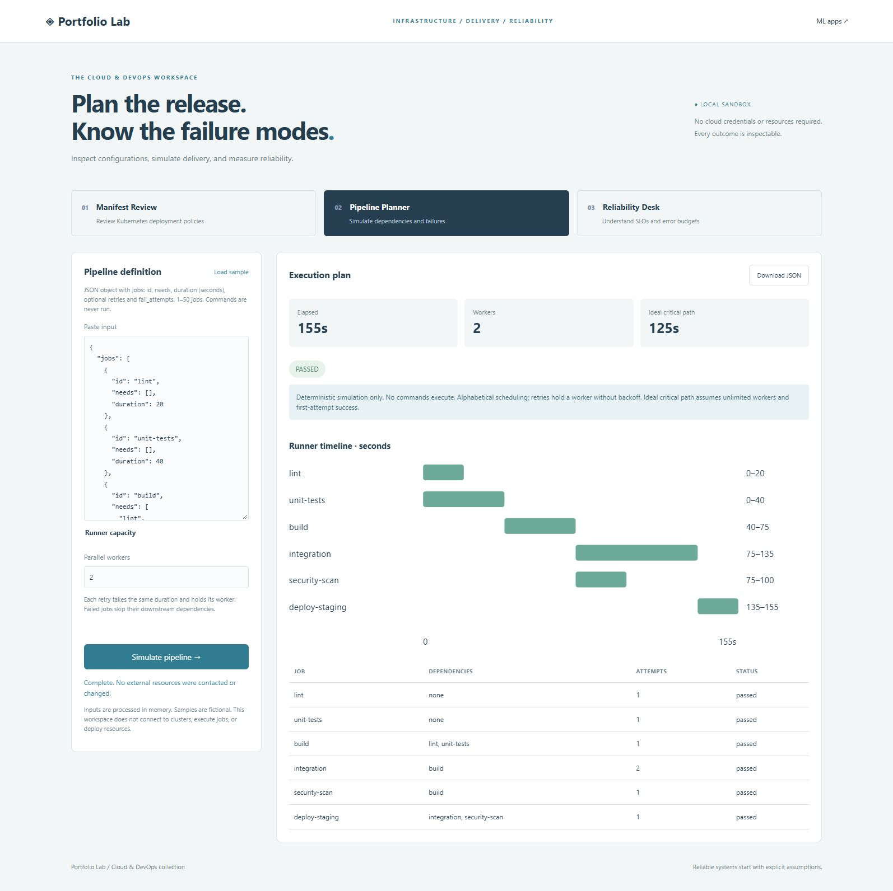

# Cloud & DevOps Lab

Run `python -m portfolio.server` from the repository and open http://127.0.0.1:8000/devops. The home-page footer links to this collection. Each app includes a fictional sample and a JSON report download. Everything runs locally with the Python standard library. No cloud accounts, credentials, clusters, deployments, or paid resources are created.



## Manifest Review

Paste one Kubernetes `apps/v1` Deployment as JSON, up to 200 KB with 1–30 containers. This tool reviews selected configuration policies and reports the precise field path:

- At least two replicas and a RollingUpdate strategy (including its default).
- Nonempty selector matchLabels consistent with the pod template.
- Container images ending in a SHA-256 digest reference.
- CPU/memory request and limit presence, and readiness/liveness probe handler presence.
- Non-root execution, disabled privilege escalation, and absence of privileged mode.

Pod-level runAsNonRoot is inherited unless explicitly overridden at container level. `observed` means a selected check matched, not that the manifest is valid, deployable, or secure. The checker does not validate resource-quantity syntax, probe handler contents, Kubernetes versions, image provenance, admission controls, node capacity, topology, network policies, rollout budgets, or cluster state. Empty probe handler objects count as present even though they may be invalid. matchExpressions are outside scope. A policy finding calls for review, not automatic remediation. No kubectl command is executed.

The [Kubernetes rolling-update documentation](https://kubernetes.io/docs/tasks/run-application/update-deployment-rolling/) explains why readiness, available capacity, maxSurge, and maxUnavailable also affect a rollout. The app only checks the strategy name; it does not certify zero downtime.

## Pipeline Planner

Paste the custom JSON format below. This is a deterministic scheduling model, not a parser/executor for GitHub Actions, Jenkins, or other CI providers.

```json
{
  "jobs": [
    {"id": "lint", "duration": 20},
    {"id": "tests", "duration": 40},
    {"id": "build", "needs": ["lint", "tests"], "duration": 35},
    {"id": "integration", "needs": ["build"], "duration": 30, "retries": 1, "fail_attempts": 1},
    {"id": "deploy", "needs": ["integration"], "duration": 20}
  ]
}
```

Supports 1–50 uniquely named jobs, durations of 1–3,600 seconds, 0–3 retries, 0–4 initial failed attempts, and 1–8 workers. Dependencies must refer to existing IDs; cycles, duplicate IDs, and duplicate dependencies are rejected. Eligible jobs start in alphabetical order when a worker is available. All dependencies must pass. Failure skips descendants while independent jobs continue.

`fail_attempts` describes how many initial attempts fail. A job passes if its retry allowance reaches a successful attempt. Every attempt takes the same duration, and retries retain a worker with no backoff. Timeline bars span all attempts, not individual retry intervals. There is no fail-fast cancellation of independent jobs, setup overhead, cache behavior, artifact transfer, approval gate, or environment locking. No command field is used and no subprocess is launched.

The ideal critical path is the longest dependency path assuming unlimited workers and first-attempt success. The report now names one such chain; equal-length choices use alphabetical order for reproducibility. It is not the exact observed runtime with capacity limits/retries, and a failed run can end sooner by skipping jobs. Downloaded reports contain all job statuses, attempts, dependencies, start/end times, and total duration. The sample browser pipeline takes 155 seconds with two workers versus a 125-second ideal critical path.

The detailed report separates each job’s eligibility time, runner queue wait, execution time, and retry time. Eligibility begins when all dependencies pass (time zero for roots). Queue wait excludes dependency waiting. Execution includes every attempt, and retry time excludes the first attempt. Skipped jobs have null eligibility/wait and zero execution. Totals use job-seconds: concurrent jobs overlap, so these totals are not additive components of elapsed wall time. Use the capacity comparison alongside these timings to distinguish runner contention from long dependencies or retry overhead.

## Reliability Desk

Paste CSV columns `timestamp,total,bad`, up to 5,000 rows under the shared 1 MB CSV limit. Each row is a completed hourly bucket whose timestamp marks its start. Timestamps need a timezone and must align to a UTC hour; equivalent timestamps in different offsets are treated as duplicates. Counts are nonnegative integers with `bad <= total`, each limited to twelve decimal digits. Missing hours are reported rather than filled with successful traffic. Data is sorted before analysis.

Choose an SLO percentage from 90 through 99.9999. The supplied rows define the reporting period; the app does not infer a monthly target or extrapolate future request volume. Define bad requests consistently with your service-level indicator.

```text
allowed error fraction = 1 - target / 100
allowed bad requests = total requests * allowed error fraction
remaining budget = allowed bad requests - observed bad requests
burn rate = (bad requests / total requests) / allowed error fraction
```

Ratios use request-weighted aggregation, not a simple average of hourly percentages. Decimal arithmetic calculates the allowance before converting report values to JSON numbers. A negative remaining budget indicates overspending. A zero-traffic aggregate has undefined success rate, burn rate, and budget consumption (null/N/A). The latest-hour rate uses the final supplied bucket. Recent six-hour burn requires exactly six consecutive buckets ending at that bucket; missing coverage returns null. This is not a live clock, monitoring agent, or alerting service. The browser shows the latest 48 buckets; exports include them all.

Reference methodology: [Google SRE error budgets](https://sre.google/workbook/error-budget-policy/) and [burn-rate alerting](https://sre.google/workbook/alerting-on-slos/). Burn rate compares the observed error ratio with the allowed ratio; a value of 1 means the ratios match. This app does not implement production multiwindow alert policies, time-to-exhaustion predictions, or deployment freezes.

## API and verification

POST endpoints require `Content-Type: application/json` and `X-Portfolio-Client: browser`. They return 200 for successful analysis and 400 for invalid input.

| Endpoint | Body |
| --- | --- |
| `/api/devops/manifest` | `text`: Deployment JSON string |
| `/api/devops/pipeline` | `text`: pipeline JSON string; optional `workers` (default 2) |
| `/api/devops/reliability` | `csv`: hourly metrics; optional `target` (default 99.9) |

All operations are stateless. Inputs are not inserted into SQLite. Reports may contain job IDs, field paths, and service metrics; review them before sharing. The existing loopback-only development server has no authentication or public hosting.

DevOps tests cover selected manifest policies and malformed shapes, dependency scheduling, ideal critical paths, worker capacity, retry success/exhaustion, transitive skips, independent-job continuation, cycles, duplicate IDs, weighted error budgets, zero traffic, metric gaps, timestamp normalization, and API routes. Browser smoke checks verified all three samples. No real Kubernetes deployment or CI-provider runtime was exercised; the existing GitHub Actions workflow runs the actual repository test suite separately from the simulator.

Next milestones: validate against a versioned Kubernetes schema, add OPA/Rego policy evaluation, import actual CI run timings, model backoff and environment locks, and ingest sanitized Prometheus metrics. Interview topics include DAG cycle detection, discrete-event simulation, retry capacity costs, the difference between configuration presence and runtime guarantees, and request-based versus time-based reliability measurement.
