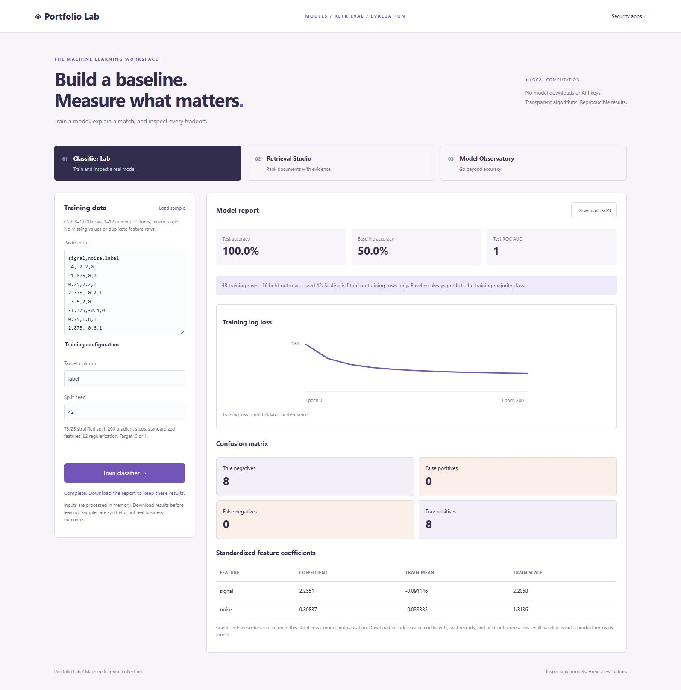

# ML Lab

Run `python -m portfolio.server` in the repository and open http://127.0.0.1:8000/ml. The product-app footer links to ML Lab. Each tab includes a synthetic sample. These are functioning classical ML and information-retrieval baselines, implemented with the Python standard library; they require no downloaded models, paid services, or API keys.



## Classifier Lab

Paste numeric CSV with a binary target column (default `label`). Supports 8–1,000 rows, 1–12 features, and at least four rows per class. Every value must be finite, and feature magnitude is bounded by 1e9. Missing values, categorical features, and duplicate feature vectors are rejected. CSV parsing also uses the shared 1 MB bound.

The implementation trains binary logistic regression with full-batch gradient descent: learning rate 0.1, 200 updates, L2 coefficient 0.01 on weights, and an unregularized intercept. The objective is mean binary cross entropy plus `0.01 / 2 * sum(weights²)`. The displayed loss is unregularized training cross entropy. Initialization is zero. The sigmoid calculation is numerically stable. This fixed-budget solver does not guarantee convergence for every dataset.

The split is stratified and reproducible for a seed and input row order. Approximately 25% of each class is held out (rounded, at least one per class). Feature means and population standard deviations are fitted only on training rows. Constant features use scale 1; nonzero scales are floored at 1e-12 for numerical stability. Tests verify that exported parameters reproduce held-out predictions. The majority-class baseline learns its class from training rows, breaking ties toward class 0.

The report includes held-out metrics, training loss history, standardized coefficients, train/test record numbers, held-out probabilities, and a portable model containing feature order, means, scales, weights, intercept, and threshold. These parameters support inference as follows:

```python
import math

def predict_probability(model, values):
    # values must be finite and in model['features'] order.
    z = model['intercept'] + sum(
        w * (x - mean) / scale
        for w, x, mean, scale in zip(
            model['weights'], values, model['means'], model['scales']
        )
    )
    return 1 / (1 + math.exp(-z)) if z >= 0 else math.exp(z) / (1 + math.exp(z))
```

The synthetic browser example is intentionally small and simple. Its scores are not evidence of real-world model quality. Repeatedly changing seeds or features based on the test score contaminates evaluation. Random splitting is inappropriate for many time-series or grouped datasets; use a suitable split before treating results as evidence. Rejecting exact duplicates does not prevent target leakage, near-duplicate leakage, or entity overlap. There is no model registry, cross-validation, fairness assessment, hyperparameter search, or production serving system.

Use **Download model JSON** in the detailed training report to save only the inference parameters. After a reload, open **Use a saved model** and choose that JSON file (or a full training report), up to 200 KB. The server validates the algorithm, feature names, numeric vectors, and threshold before enabling batch prediction. Imported models reuse their original scaling and threshold; nothing is retrained or stored. Batch predictions can be downloaded as CSV.

## Retrieval Studio

Paste 2–100 documents separated by a line containing `---`, then enter a query. The corpus is limited to 200 KB, and the query to 500 characters. Processing lowercases text, extracts word tokens of two or more characters, removes a small explicit English stopword list, and constructs normalized sparse TF-IDF vectors.

Weights use sublinear term frequency `1 + log(count)` and smoothed inverse document frequency `log((1 + documents)/(1 + document_frequency)) + 1`. Both document and query vectors are L2 normalized. Ranking uses cosine similarity; each result lists the query terms contributing to its score. Ties retain document order. Unknown query words are reported; a query without matching vocabulary returns no results. Choose up to 20 positive matches (default ten), with excerpts of up to 600 characters.

Analysis settings also offer BM25 with `k1=1.5`, `b=0.75`, and unique query terms. Its inverse document frequency is `log(1 + (N - df + 0.5)/(df + 0.5))`, as documented by [Apache Lucene](https://lucene.apache.org/core/10_5_2/core/org/apache/lucene/search/similarities/BM25Similarity.html); this app uses its own tokenizer and explicit parameters, not Lucene score parity. The term factor is `count * (k1 + 1) / (count + k1 * (1 - b + b * length / average_length))`. BM25 scores are unbounded ranking values.

Term badges now explain the selected algorithm, ordered by contribution. The JSON report preserves `contribution` for the selected algorithm, plus `tfidf_contribution`, `bm25_contribution`, `term_frequency`, and `document_frequency` for each matching term. Contributions reconcile with their corresponding scores within floating-point precision; displayed rounding may differ slightly. BM25 ignores repeated query terms while TF-IDF uses their frequencies. Tests check both decompositions and a hand-calculated corpus; the browser example shows 0.671 + 0.470 = 1.141 for its first result ([capture](design/retrieval-explanations.png)).

This is lexical retrieval, **not neural semantic search or an LLM**. It does not generate answers, perform stemming, understand synonyms, retain an index, or provide multilingual semantic understanding. A document excerpt can contain untrusted text; it is displayed as escaped text rather than executed. Similarity scores are not probabilities or correctness estimates. The transparent baseline is useful before comparing an embedding-based retriever on a labeled relevance dataset.

## Model Observatory

Paste CSV with `actual` labels (0 or 1) and `score` probabilities for class 1, up to 5,000 rows under the shared CSV limits. Select a threshold; prediction is positive when `score >= threshold`.

The app reports accuracy, precision, recall, F1, confusion counts, ROC AUC, binary Brier loss, and log loss. ROC AUC uses average ranks for ties and is undefined when only one class is present. Precision, recall, and F1 return null/N/A when their denominator is zero. Brier loss is the mean squared error of binary probabilities. Log-loss logarithm inputs are floored at 1e-15 to avoid infinities. A threshold table covers 0.0 through 1.0 in steps of 0.1. Five equal-width calibration bins compare average score and observed positive frequency; empty bins return null. Bins include their lower bound and exclude their upper bound, except the final bin includes 1.0.

Choose thresholds using validation data, then evaluate on a separate test set. There are no confidence intervals, statistical comparisons between models, subgroup guarantees, or automatic threshold recommendations. Reports with few samples or imbalanced labels need cautious interpretation. Scores are assumed to be probabilities, not arbitrary logits.

## API and privacy

POST requests require `Content-Type: application/json` and `X-Portfolio-Client: browser`. Successful analysis returns 200; invalid input returns 400.

| Endpoint | JSON fields |
| --- | --- |
| `/api/extensions/model` | `text`: raw model or training-report JSON |
| `/api/extensions/predict` | `model`, `csv`, optional `threshold` |
| `/api/ml/train` | `csv`, optional `target` (default `label`), optional integer `seed` (default 42) |
| `/api/ml/search` | `documents`, `query` |
| `/api/ml/evaluate` | `csv`, optional `threshold` (default 0.5) |

Inputs and models are processed in memory, not saved to SQLite or uploaded to third-party services. Downloads contain model parameters, derived results, or document excerpts, so review reports before sharing. The loopback development server is not a public deployment platform.

## Tests and next steps

ML tests cover known AUC examples and ties, confusion counts, probability losses, undefined metrics, calibration boundaries, invalid probabilities, deterministic fitting, training-only scaling, disjoint splits, exported-model inference, duplicate rows, search rankings, unseen terms, invalid corpora, and HTTP routes. Browser smoke checks verify all three sample flows. Automated browser/mobile regression tests are future work.

Next milestones: compare outputs against a pinned scikit-learn reference, add cross-validation with proper preprocessing isolation, save versioned experiment metadata, benchmark retrieval with relevance judgments, and compare lexical retrieval to a local embedding model. The current code does not depend on scikit-learn and is not claimed to be bit-for-bit equivalent to its solvers.

References used for methodology: [scikit-learn data-leakage guidance](https://scikit-learn.org/stable/common_pitfalls.html), [TF-IDF vectorization](https://scikit-learn.org/stable/modules/generated/sklearn.feature_extraction.text.TfidfVectorizer.html), [ROC AUC](https://scikit-learn.org/stable/modules/generated/sklearn.metrics.roc_auc_score.html), and [Brier score](https://scikit-learn.org/stable/modules/generated/sklearn.metrics.brier_score_loss.html). Preprocessing is learned from training data, and the retrieval implementation follows the documented normalized TF-IDF approach.

## Local input files

Classifier Lab and Model Observatory accept UTF-8 CSV files up to 1 MB. Retrieval Studio accepts UTF-8 `.txt` collections up to 200 KB, using the same `---` document separators as pasted input. Files populate the editable input and are not analyzed until you run the tool. Invalid encoding, empty files, and oversized files leave the existing input intact. A newer file, manual edit, sample, mode switch, or analysis run supersedes an earlier pending file read. Column suggestions update after CSV loading.

Manual workflow captures: [portable model inference](design/saved-model-workflow.png) and [invalid UTF-8 upload preserving a completed report](design/ml-file-recovery.png).

### Prediction error audit

Model Observatory includes source record numbers, actual labels, scores, and predicted classes for every evaluated row in its JSON report. Detailed analysis shows the first 20 misclassified records and offers a full prediction-audit CSV containing all rows, outcome names, the selected threshold, and each error’s configured cost. The audit uses the threshold you entered; it does not silently substitute the best threshold from the coarse cost grid. Extra input columns are omitted. Join the logical record number back to the input when investigating errors (header is record 1; blank physical rows are skipped).

Tests reconcile all four outcomes with the confusion matrix, cover score-equals-threshold behavior and asymmetric error costs, and verify a 5,000-row export keeps every record and full score precision despite the bounded preview. A browser download was checked against the displayed threshold and confusion matrix ([capture](design/prediction-audit.png)).
