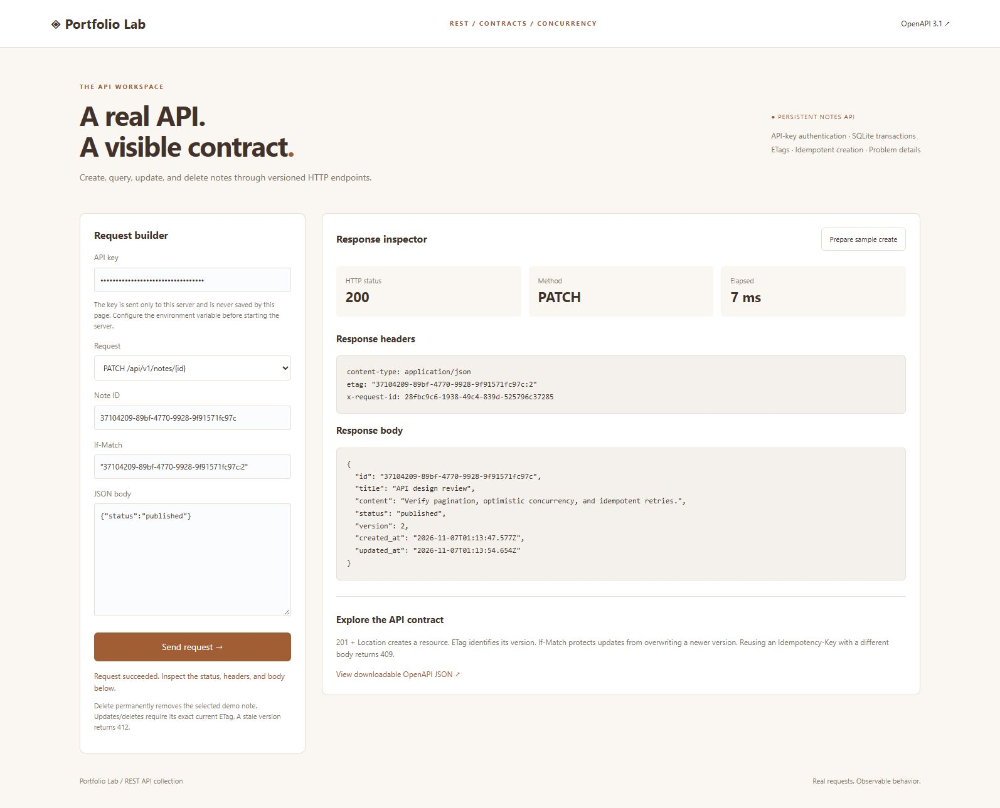

# REST Studio and Notes API

A real SQLite-backed resource API with a browser request builder, OpenAPI contract, and runnable Python client. Routes are versioned under `/api/v1/notes`. These routes use an API key; the other portfolio apps keep their existing local-demo behavior.



## Start locally

From the repository root in PowerShell, generate a session key, copy it for the explorer, and start the server:

```powershell
$env:PORTFOLIO_API_KEY = python -c "import secrets; print(secrets.token_urlsafe(32))"
Set-Clipboard $env:PORTFOLIO_API_KEY
python -m portfolio.server
```

Open http://127.0.0.1:8000/rest and paste the key into the password field. The explorer keeps it in memory only; it does not use localStorage or cookies. The key is captured from the environment when the server starts; restart to change it. A missing server key disables the versioned API with 503. Requests with a missing or wrong client key receive 401. No key is included in the source repository, response body, or OpenAPI document. Tests use explicitly fictional keys.

In another terminal configured with the same `PORTFOLIO_API_KEY`, run:

```sh
python -m portfolio.rest_client
```

The client creates its own temporary note, retries creation with the same idempotency key, lists notes, retrieves the resource, checks HEAD metadata, validates an unchanged version with a 304, updates it, verifies the old validator now returns the changed representation, and deletes its temporary note. An integration test runs this complete CLI workflow against an isolated server and confirms that no demo note remains. `--base-url http://127.0.0.1:8765` supports a different local port. The client sends its key to the selected base URL, so choose that destination deliberately.

## Resource model and routes

A note has UUID `id`, `title` (1–200 characters, trimmed), `content` (1–10,000 characters, whitespace-only rejected), `status` (`draft` or `published`), integer `version`, and UTC `created_at`/`updated_at` timestamps. Unknown input fields and duplicate JSON keys are rejected. Create and replace require all three writable fields; PATCH accepts one or more writable fields.

Headers that identify a single credential, body type, creation retry key, or write version must not be repeated: duplicate `X-API-Key`, `Content-Type` on JSON writes, `Idempotency-Key` on creation, and `If-Match` on updates/deletion return 400 before mutation. Header names are case-insensitive, and even identical duplicates are rejected. Repeated `If-None-Match` fields remain supported as a combined validator list for individual-note reads.

| Method | Route | Behavior |
| --- | --- | --- |
| GET | `/api/v1/notes` | List, filter, search, paginate |
| POST | `/api/v1/notes` | Create; returns 201, Location, ETag |
| GET | `/api/v1/notes/{id}` | Retrieve a note and ETag; optional If-None-Match |
| HEAD | Both resource paths | GET metadata without a body; optional If-None-Match on individual notes |
| PUT | `/api/v1/notes/{id}` | Replace writable fields; requires If-Match |
| PATCH | `/api/v1/notes/{id}` | Partial update; requires If-Match |
| DELETE | `/api/v1/notes/{id}` | Permanently delete; requires If-Match; returns empty 204 |
| OPTIONS | Both resource paths | Empty 204 with Allow header |

Every route above requires `X-API-Key`. Write bodies use `application/json` and have a 65,536-byte limit. Chunked request bodies are unsupported. The explorer and `/openapi.json` are public local documentation endpoints. These API routes do not require the older `X-Portfolio-Client` header.

### Querying

Collection GET supports `page` (default 1, maximum 100,000), `page_size` (default 20, maximum 100), optional `status`, and optional `q` (up to 200 characters). Search is a literal case-insensitive substring over title/content using SQLite's default case folding, which is primarily ASCII. Query parameters cannot repeat. Unknown parameters are rejected.

Responses contain `items`, `page`, `page_size`, `total`, and a relative `next` link or null. Ordering is `created_at DESC, id DESC`. Count and rows are read in one database transaction. This is offset pagination: records inserted or deleted between requests can shift page boundaries. It is not a cross-request snapshot or cursor pagination implementation.

HEAD supports the same resources, authentication, and query validation as GET, with matching response metadata and no body. Request-body reads have a 15-second absolute deadline in addition to the socket inactivity timeout. Receiving partial chunks does not restart that deadline. Truncated bodies and duplicate length headers are rejected. Both API adapters return 408 when body reading times out; this deadline does not cover application computation or SQLite writes.

### Conditional updates

GET, HEAD, and successful writes return a strong ETag shaped as `"uuid:version"`. Send that exact value in `If-Match` for PUT, PATCH, or DELETE. Missing preconditions return 428; stale or unsupported tags return 412. For write preconditions, wildcards, weak validators, and comma-separated ETag lists are not supported. Successful PUT/PATCH increments the version, including same-value updates.

The ETag comparison and mutation run inside one `BEGIN IMMEDIATE` transaction. Two competing writers using the same version cannot both succeed. A 412 response is a request to fetch the latest note and reconsider the edit; the server does not merge conflicting changes automatically.

### Conditional reads

Individual-note GET and HEAD accept optional `If-None-Match`. A matching tag (including a weak `W/` tag), a matching member of a comma-separated list, or `*` returns 304 with the current ETag and no body. Nonmatching tags return the usual 200 response. Authentication and missing-resource checks still apply. Tag lists allow quoted commas and repeated header lines; malformed values return 400. Input is limited to 8,192 combined characters and 100 tags. Collection reads and write operations reject this header with 400 rather than silently ignoring an unsupported condition.

The browser offers HEAD and an optional If-None-Match field for individual-note reads, records 304 in request history, and shows an explicit empty-response explanation. It does not substitute an earlier response body. Responses remain `Cache-Control: no-store`; this feature demonstrates explicit version validation, not persistent browser caching. A new note selection clears the read condition. The OpenAPI contract includes the conditional parameter and bodyless 304 response.

Matching follows [RFC 9110 If-None-Match semantics](https://www.rfc-editor.org/rfc/rfc9110.html#section-13.1.2). Empty 204 and 304 responses omit Content-Length; HEAD 200 reports the matching GET representation length, following [HTTP content-length rules](https://www.rfc-editor.org/rfc/rfc9110.html#section-8.6). Tests cover matching, stale, weak, list, wildcard, malformed, oversized, unauthorized, and missing-note cases. Browser checks verified GET 200 → conditional GET 304 and HEAD 200 without a response body ([capture](design/rest-conditional-read.png)).

### Retry-safe creation

POST accepts an optional `Idempotency-Key` of 1–128 ASCII letters, digits, `_`, `.`, `:`, or `-`. The first request stores a canonical payload hash and the original response atomically with the note. Concurrent duplicate requests create one resource. Repeating the key with the same validated payload returns the original 201 response and `Idempotency-Replayed: true`; a changed payload returns 409.

Keys are scoped to the configured API key's SHA-256 digest. They are not automatically expired. The stored response is a snapshot: after a note is updated or deleted, replay still returns the original creation response/ETag and does not recreate a deleted note. Fetch Location to determine current state. Key rotation creates a new idempotency scope but does not create separate note ownership. Idempotency records retain the original note content even after deletion, so deletion is not an erasure workflow. Add retention rules before using this design with real sensitive records.

## Errors and contract

Implemented REST operations return errors as `application/problem+json` with `type`, `title`, `status`, `detail`, and `instance`, following the basic [RFC 9457 problem-details structure](https://www.rfc-editor.org/rfc/rfc9457.html). Each response includes a generated `X-Request-ID`. Unsupported implemented methods return 405 with Allow. Error messages avoid echoing keys or entire request bodies. The base Python server can still emit its own errors for unsupported protocol methods or malformed HTTP framing.

Common status codes: 400 malformed JSON/query, 401 invalid key, 404 missing resource, 405 unsupported method, 408 request body timeout, 409 idempotency conflict, 412 stale ETag, 413 body size, 415 content type, 422 field validation, 428 missing precondition, and 503 unconfigured API.

The checked-in [OpenAPI JSON](../portfolio/static/openapi.json) describes paths, request bodies, schemas, API-key security, and response headers using [OpenAPI 3.1.1](https://spec.openapis.org/oas/v3.1.1.html). Regenerate with `python -m portfolio.openapi`. A test ensures the checked-in document matches its generator. It is usable as an API reference/import contract; no third-party OpenAPI validator or generated SDK is claimed.

## Verification and scope

Automated checks cover persisted CRUD, replacement/partial updates, deletion, request validation, authentication, missing server configuration, filter/pagination behavior, method discovery, ETags, concurrent writers, concurrent idempotency replay, replay after deletion, problem responses, static assets, and contract regeneration. The Python sample client was run end to end. Browser checks verified authenticated creation and conditional PATCH from version 1 to version 2. Automated browser/mobile tests remain future work.

The server binds to loopback and remains a local demo on Python's development HTTP server. API-key authentication covers only `/api/v1` and does not make the rest of the portfolio internet-ready. There is one shared workspace, no per-user ownership, OAuth, TLS termination, rate limiting, key rotation service, idempotency TTL, or production deployment. UUIDs are identifiers, not authorization boundaries. Notes and idempotency snapshots persist in the existing ignored SQLite database. Future milestones: a production framework, identity and resource ownership, cursor pagination, retention/erasure policies, structured observability, and a generated client validated against the schema.

## Browser request recovery

REST Studio allows cancelling an in-flight request and imposes a 30-second deadline that includes reading the complete response body. The builder is restored after success, cancellation, timeout, or network failure. Inputs are retained and prior responses are explicitly labeled as old when no complete new response arrives. Cancelling the browser request does not roll back a server transaction. For an uncertain create, retry only with the same idempotency key and body; otherwise fetch the current state before deciding what to do. The UI never retries writes automatically.

Transport tests cover stalled bodies, cancellation before and during fetch, HTTP error responses, timer cleanup, and recovery wording for reads versus writes. A delayed local QA server was used to verify the visible Cancel request workflow.

The outer local HTTP adapter validates Host before API authentication or routing. Missing, duplicate, or non-loopback Host values return a generic 400 JSON error rather than a route-specific problem response. Use the documented localhost/127.0.0.1 URL; custom hostnames and forwarded-host overrides are unsupported.

[Cancelled-request browser capture](design/rest-cancellation.png), using a deliberately delayed local QA response.

## Reusing request collections

REST Studio can import its exported `portfolio-lab-request-collection-v1` files through **Import a request collection** beneath session history. Choose a UTF-8 JSON file up to 1 MB containing 1–10 requests, then choose **Prepare imported request**. Import and preparation make no API calls. Review the body, current version, and idempotency key before explicitly sending; saved validators may be stale. API authentication must be supplied separately and is never imported.

The parser accepts only supported methods and local Notes API paths. It restores list filters, bodies (including intentionally malformed JSON used to test errors), conditional headers, and creation idempotency keys. External URLs, authentication/unsupported headers, repeated query parameters, and invalid method/path combinations are rejected. Imported items are separate from completed-response history; saved status/timing metadata is ignored. A malformed file leaves the previous import and builder untouched, and newer file selections supersede pending older reads. Imported requests stay only in memory until the page is left.

Tests cover all seven operations, malformed collections, unsupported paths/headers, query bounds, and atomic validation. A browser check prepared a POST without sending it, retained a previous import after a malformed file, and round-tripped an exported GET with filters ([capture](design/request-collection-import.png)).
