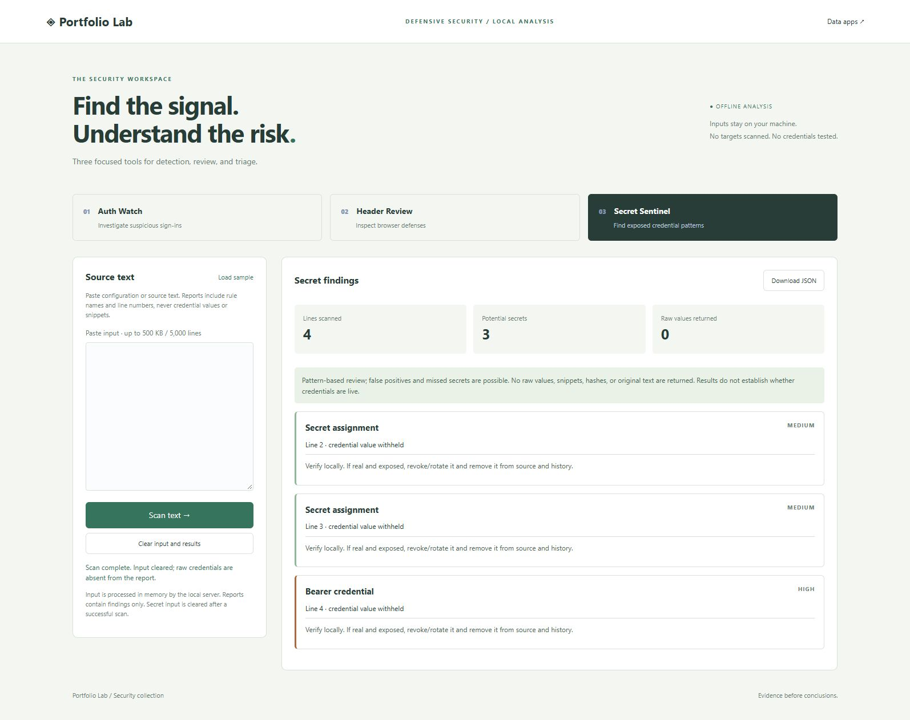

# Security Lab

Three defensive security applications at http://127.0.0.1:8000/security after running `python -m portfolio.server` from the repository root. Use **Load sample** in each tab for fictional inputs. No external targets are contacted, no credentials are tested, and no API keys or additional packages are needed.



## Auth Watch

Paste JSON Lines with `timestamp`, `ip`, `user`, and `status`. Timestamps must contain timezone offsets; status is `failure` or `success`. Invalid lines are reported without echoing their contents. Accepted events are normalized to UTC and sorted by timestamp and input order.

```json
{"timestamp":"2026-01-15T10:00:00Z","ip":"192.0.2.10","user":"demo-user","status":"failure"}
```

The configurable threshold is 2–100 failures, and the inclusive rolling window is 1–60 minutes (defaults: 5 failures / 10 minutes). Rules detect:

- Failure bursts from the same source IP.
- Failures against threshold-many distinct accounts from one source.
- A successful sign-in after threshold-many failures for the same source/account pair.

Source alerts fire on threshold crossing and rearm when the corresponding window count falls below the threshold. A success clears that account/source failure history, preventing repeated success alerts for the same evidence. Source-wide failure history remains until it expires. Duplicate input events are retained, so duplicate ingestion can inflate counts. These rules do not detect distributed spraying, and NAT, shared proxies, clock skew, or routine user mistakes may cause misleading results. Alerts are investigation leads, not proof of compromise. Reports contain usernames and IPs from accepted events; handle them accordingly.

## Header Review

Paste one response-header block. The tool reviews enforcing CSP script restrictions, framing restrictions, HSTS lifetime, MIME-sniffing policy, referrer policy, and cookie attributes. Header names are case-insensitive. Repeated policy headers and malformed lines are flagged; Set-Cookie is evaluated individually. Report-only CSP does not count as enforcement. Script checks include the `script-src-elem` and `script-src-attr` fallback chains, so a restrictive base directive cannot hide an explicitly broad override. Cookie checks flag duplicate attributes and `__Host-` prefix violations (missing `Path=/` or a specified `Domain`). Raw header and cookie values are omitted from results.

`observed` means the simple rule matched, not that a site is secure or its policy is valid. This is deliberately not a complete CSP parser or browser emulator: multiple policies, nonce handling, invalid source syntax, and application-specific cookie purposes require human review. The one-year HSTS check is this project's review threshold, not a universal requirement. There is no URL fetch, TLS inspection, redirect analysis, or exploit testing.

Reference material: [MDN CSP guide](https://developer.mozilla.org/en-US/docs/Web/HTTP/Guides/CSP), [MDN frame-ancestors](https://developer.mozilla.org/en-US/docs/Web/HTTP/Reference/Headers/Content-Security-Policy/frame-ancestors), [MDN script element overrides](https://developer.mozilla.org/en-US/docs/Web/HTTP/Reference/Headers/Content-Security-Policy/script-src-elem), [MDN script attribute overrides](https://developer.mozilla.org/en-US/docs/Web/HTTP/Reference/Headers/Content-Security-Policy/script-src-attr), [MDN cookie prefix requirements](https://developer.mozilla.org/en-US/docs/Web/HTTP/Reference/Headers/Set-Cookie), and [Mozilla web security guidelines](https://infosec.mozilla.org/guidelines/web_security). CSP frame-ancestors controls embedding, and modern CSP offers more flexible framing rules than X-Frame-Options. These references informed the checks; the app implements only a small heuristic subset.

## Secret Sentinel

Scans pasted text for private-key blocks (including encrypted PEM blocks), legacy and fine-grained GitHub-style tokens, AWS-style access-key IDs, common credential assignments (including AWS secret/session keys and refresh tokens), and bearer credentials. Overlapping matches are merged. Results contain rule, severity, line number, and remediation guidance. They never include matched values, snippets, fingerprints, hashes, or the original text. The browser clears the input after a successful scan. The fictional samples intentionally match rules and contain no working credentials.

This is pattern matching, not a full repository scanner: it does not inspect Git history, nested files, encoded content, all provider formats, or token validity. The `github_pat_` prefix follows [GitHub’s credential type reference](https://docs.github.com/en/organizations/managing-programmatic-access-to-your-organization/github-credential-types); matching is deliberately heuristic and does not validate issuance, scope, or token length against a live service. Findings may be false positives; no findings does not prove an absence of secrets. It generates a value-free report, not a rewritten/sanitized copy of the input. If a real secret was exposed, verify and rotate/revoke it with its provider; deleting a string alone does not revoke it.

## Input handling and API

Inputs are bounded to 500,000 UTF-8 bytes and 5,000 lines. They are processed in memory and are not inserted into SQLite or written to application logs. HTTP access logs record request paths/statuses only. Clearing fields is not guaranteed memory zeroization; normal browser, OS, and process memory behavior still applies. This remains a loopback-only demo without authentication, not a production security platform.

POST endpoints require `Content-Type: application/json` and `X-Portfolio-Client: browser`:

| Endpoint | Body |
| --- | --- |
| `/api/security/logs` | `{"text":"JSON Lines here","threshold":5,"window_minutes":10}` |
| `/api/security/headers` | `{"text":"X-Frame-Options: DENY"}` |
| `/api/security/secrets` | `{"text":"source text here"}` |

Success is 200; invalid top-level inputs are 400. Auth Watch reports invalid individual events in `rejected`. Download JSON exports the complete findings report. All browser text is escaped before HTML insertion.

## Verification and portfolio discussion

Security tests cover chronological sorting, inclusive window boundaries, success correlation, distinct-user thresholds, rearming, invalid events, report-only CSP, duplicate headers, cookie-value omission, overlapping secret matches, multiline key detection, size limits, API responses, and absence of credential values in serialized reports. Manual browser checks verified all three sample flows and secret input clearing. Automated mobile/accessibility and browser regression tests remain future work.

Interview topics: explain false positives and false negatives, event-time versus ingestion-time processing, inclusive window boundaries, why a successful login does not establish compromise, and why secret scanners must avoid leaking findings. Useful follow-ups include configurable detection rules, deduplicated ingestion, synthetic benchmark datasets, additional token detectors, and integration with a real CSP parser. Do not claim production incident response or discovered vulnerabilities from fictional examples.

## Reproducible rolling-window benchmark

Auth Watch maintains per-source user counts as failures enter and leave the time window, avoiding repeated reconstruction of the user set. Existing alert rules and inclusive window boundaries are preserved.

Run `python -m benchmarks.auth_logs --baseline ca152db --events 4000 --runs 5` from the repository root to compare with the prior implementation. The script checks report equality before timing. A local Windows / Python 3.13.17 run measured medians of 26.7 ms for the incremental implementation and 520.2 ms for the baseline. This measures the repeated-source synthetic fixture; other workloads and machines differ. An additional manual equivalence check compared 100 randomized batches with mixed sources, users, successes, and timestamps.

## Secret scan timing fixture

```sh
python -m benchmarks.secret_scan --baseline ba1ccc0 --findings 4000 --runs 5
```

The fixture contains 4,000 synthetic password assignments, with no real credentials. Before timing, the harness verifies that both revisions return identical reports. One Windows/Python 3.13.17 run measured a five-run median of 19.692 ms for indexed line lookup versus 274.793 ms for the earlier repeated-prefix scan. Hardware, input shape, and system load affect timings; this is not a general speedup guarantee or a CI performance threshold. The optional baseline executes the security module from the named local Git revision, so compare reviewed revisions only. Line-location tests also cover LF, CRLF, CR, and Unicode line separators.

Security reports display at most 50 finding cards per page, with keyboard-accessible previous/next controls and an announced range. Changing pages keeps the detailed analysis and export controls intact. Totals, downloaded JSON, and redacted findings CSV contain all findings, not just the visible page.

[Paginated report and full-export browser capture](design/security-pagination.png), using 120 synthetic findings.
